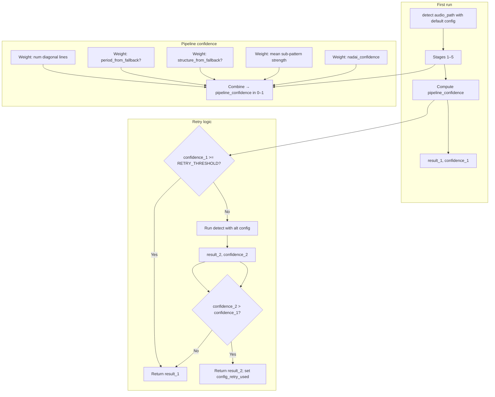

# Improvement 6: End-to-End Confidence and Retry

**Goal:** Define a **pipeline-level confidence score** (0–1) from the quality of each stage, and **automatically retry** with an alternative config (e.g. different `FEATURE_TYPE` or `SSM_METRIC`) when confidence is below a threshold. Students implementing this improvement will add **confidence aggregation** and a **config retry loop** so the pipeline returns the best available result or a clear warning.

---

## 1. Concept

### Why it matters

- **Single score:** Different stages produce signals (e.g. number of diagonal lines, sub-pattern strength, period fallback, nadai confidence). A single **pipeline_confidence** makes it easy for callers to filter (e.g. “only show results above 0.7”) or to show a “reliability” indicator.
- **Retry:** Sometimes the default config (e.g. `FEATURE_TYPE='combined'`, `SSM_METRIC='cosine'`) does not suit a given recording. **Automatically** re-running the pipeline with one alternative (e.g. `tempogram` or `correlation`) and comparing confidence lets the pipeline self-correct without user intervention. Return the **higher-confidence** result (or the original with a warning if the retry did not improve).

### What to add

1. **Pipeline confidence**  
   After all stages, compute a score that combines (with weights or a simple formula):  
   - Number of diagonal lines (e.g. normalise by a target range).  
   - Whether period/structure came from fallback (e.g. reduce score if True).  
   - Sub-pattern strength (e.g. mean strength of used sub-patterns).  
   - Nadai confidence (from Improvement 5).  
   Add `pipeline_confidence` to the result dict (0–1). Optionally add per-stage contributions for debugging.

2. **Config retry loop**  
   If `pipeline_confidence < CONFIDENCE_RETRY_THRESHOLD` (e.g. 0.5), run the pipeline **once more** with an alternative config: e.g. next entry in `FEATURE_FALLBACK_ORDER` or a different `SSM_METRIC`. Compare the two `pipeline_confidence` values; return the result with **higher** confidence. If the retry result is used, set a flag e.g. `config_retry_used = True` and which config was used. Cap total runs (e.g. 2) to avoid long runs.

---

## 2. Potential Python libraries

| Library | Use | Documentation |
|--------|-----|----------------|
| **NumPy** | Weighted sum or min/max for combining scores; clip to [0, 1]. | [NumPy](https://numpy.org/doc/stable/) |

No new dependencies. Logic lives in the pipeline controller.

---

## 3. Flowchart of the improvement

**Integration points:**

- **Confidence:** In `detect()`, after building the result dict, call a helper e.g. `compute_pipeline_confidence(result)` that takes the result (with optional flags from Improvements 4 and 5), computes the weighted score, and returns a float. Assign to `result['pipeline_confidence']`.
- **Retry:** In `detect_and_save` (or in `detect` with a parameter), after the first `detect(audio_path)`, check `result['pipeline_confidence']`. If below threshold, call `detect(audio_path, feature_type=..., ssm_metric=...)` or equivalent with one alternative config, compute confidence for the second result, and return the better one. Ensure `detect` can accept optional overrides for config (e.g. keyword args that override settings for that run only).

---

## 4. Implementation notes for students

- **Config:** Add `CONFIDENCE_RETRY_THRESHOLD` (e.g. 0.5), `CONFIDENCE_WEIGHTS` (dict or list for each component), and `RETRY_ALTERNATIVE_CONFIGS` (e.g. list of `[{'FEATURE_TYPE': 'tempogram'}, {'SSM_METRIC': 'correlation'}]`). Max 1 retry keeps behaviour predictable.
- **Overrides:** The pipeline currently reads from `config.settings`. For retry, either (a) pass overrides into `detect(...)` and have each stage read from a “run config” dict that merges settings with overrides, or (b) temporarily mutate `config.settings` (not ideal for threading) or use a context manager. Prefer (a) for clarity.
- **Result:** Always attach `pipeline_confidence` to the result. When retry is used, attach `config_retry_used = True` and `config_retry_alternative` (e.g. the dict used for the winning run) so reports can show “Result from fallback config: FEATURE_TYPE=tempogram”.
