# Nadai Detection Pipeline — Flowchart

Main controller: **`main()`** → **`NadaiDetectionPipeline.detect_and_save()`** → **`detect()`**. All callees are included below.

```mermaid
flowchart TB
    subgraph Entry[" "]
        main["main()"]
    end

    main --> parse["argparse: audio_file, -o, -q"]
    parse --> create["NadaiDetectionPipeline(verbose)"]
    create --> detect_save["detect_and_save(audio_path, output_dir)"]

    detect_save --> detect["detect(audio_path)"]

    subgraph Stage0["Stage 0: Validation"]
        detect --> validate["validate_audio_file(audio_path)"]
        validate --> path_check["Path.exists(), suffix in SUPPORTED_FORMATS"]
        validate --> get_info["get_audio_info(audio_path)"]
        get_info --> sf_info["soundfile.info() or librosa.load() fallback"]
        validate --> duration_check["duration in [MIN, MAX]"]
    end

    subgraph Stage1["Stage 1: Feature Extraction"]
        detect --> extract_feat["extract_features(audio_path, feature_type)"]
        extract_feat --> feat_init["FeatureExtractor(sr, hop_length)"]
        feat_init --> feat_ext["extractor.extract(audio_path, feature_type)"]
        feat_ext --> load_audio["librosa.load(audio_path)"]
        feat_ext --> branch_feat{"feature_type?"}
        branch_feat --> mfcc["_extract_mfcc(y, sr)"]
        branch_feat --> chroma["_extract_chroma(y, sr)"]
        branch_feat --> tempogram["_extract_tempogram(y, sr)"]
        branch_feat --> combined["_extract_combined(y, sr)"]
        mfcc --> frames_time["librosa.frames_to_time(...)"]
        chroma --> frames_time
        tempogram --> frames_time
        combined --> frames_time
    end

    subgraph Stage2["Stage 2: Self-Similarity Matrix"]
        detect --> compute_ssm["ssm_analyzer.compute_ssm(features, normalize)"]
        compute_ssm --> norm["librosa.util.normalize (if normalize)"]
        compute_ssm --> pdist["pdist(features, metric)"]
        compute_ssm --> squareform["squareform → similarity matrix"]
        detect --> enhance_ssm["ssm_analyzer.enhance_ssm(ssm) [if SSM_ENHANCE]"]
        enhance_ssm --> uniform_filter["scipy.ndimage.uniform_filter"]
    end

    subgraph Stage3["Stage 3: Repetition Detection"]
        detect --> find_diag["ssm_analyzer.find_diagonal_lines(ssm, times, min_length, threshold)"]
        find_diag --> scan_lags["scan lags; threshold; min_frames"]
        find_diag --> create_line["_create_line_dict(line_indices, lag, times, ssm)"]
    end

    subgraph Stage4["Stage 4: Rhythm Structure"]
        detect --> analyze_rep["rep_detector.analyze_repetition(diagonal_lines, ssm, times)"]
        analyze_rep --> find_period["_find_period(diagonal_lines)"]
        find_period --> cluster_lags["cluster lag_times; median(largest_cluster)"]
        analyze_rep --> find_sub["_find_sub_patterns(diagonal_lines, period)"]
        find_sub --> group_lag["_group_by_lag(diagonal_lines, period)"]
        find_sub --> divisions["period/lag ≈ integer; strength ≥ 0.5"]
        analyze_rep --> determine_struct["_determine_structure(period, sub_patterns)"]
        determine_struct --> factor["beat_count × nadai = total_divisions"]
    end

    subgraph Stage5["Stage 5: Nadai Classification"]
        detect --> classify["classify_nadai(subdivisions_per_beat)"]
        classify --> defs["NADAI_DEFINITIONS lookup"]
        classify --> power2["_is_power_of_2(n)"]
    end

    detect --> compile["compile result dict"]

    subgraph Output["Output (if output_dir)"]
        detect_save --> out_json["Save JSON (if OUTPUT_JSON)"]
        detect_save --> out_plot["visualize_complete_analysis(result, audio_path, save_path)"]
        detect_save --> out_report["generate_report(result, report_path)"]
    end

    subgraph Vis["visualize_complete_analysis"]
        out_plot --> plot_ssm["plot_ssm(ax, result)"]
        out_plot --> plot_time_lag["plot_time_lag(ax, result)"]
        out_plot --> plot_sub["plot_sub_patterns(ax, result)"]
        out_plot --> plot_strength["plot_diagonal_strength(ax, result)"]
        out_plot --> plot_summary["plot_summary(ax, result)"]
        plot_time_lag --> compute_lag["compute_time_lag_matrix(ssm, times)"]
        out_plot --> savefig["plt.savefig(save_path)"]
    end

    subgraph Report["generate_report"]
        out_report --> gen_summary["generate_summary(result)"]
        gen_summary --> write_file["open(output_path, 'w').write(report)"]
    end

    Stage0 --> Stage1
    Stage1 --> Stage2
    Stage2 --> Stage3
    Stage3 --> Stage4
    Stage4 --> Stage5
    Stage5 --> compile
    compile --> Output
```

---

## What each method does

### Entry

- **`main()`** — Command-line entry point. Parses arguments (audio file path, output directory, quiet flag), creates the pipeline, and calls `detect_and_save()`.
- **`NadaiDetectionPipeline(verbose)`** — Builds the pipeline and creates the SSM analyzer and repetition detector used in later stages.
- **`detect_and_save(audio_path, output_dir)`** — Runs the full detection pipeline, then (if `output_dir` is set) writes JSON, plot, and text report to disk.

---

### Stage 0: Validation

- **`validate_audio_file(audio_path)`** — Ensures the input is usable: file exists, extension is supported (e.g. .wav, .mp3, .flac), and the file can be read.
- **Path/suffix check** — Confirms the path exists and the suffix is in `SUPPORTED_AUDIO_FORMATS`.
- **`get_audio_info(audio_path)`** — Reads metadata (duration, sample rate, channels). Tries `soundfile` first; if the format isn’t recognised, falls back to loading with `librosa` to get duration and sample rate.
- **Duration check** — Ensures duration is between `MIN_AUDIO_DURATION` and `MAX_AUDIO_DURATION` (e.g. 2 s–10 min).

---

### Stage 1: Feature extraction

- **`extract_features(audio_path, feature_type)`** — Convenience wrapper that creates a `FeatureExtractor` and calls its `extract()` with the chosen feature type.
- **`FeatureExtractor(sr, hop_length)`** — Holds sample rate and hop length used for framing and feature computation.
- **`extractor.extract(audio_path, feature_type)`** — Loads the audio with librosa, computes the requested feature representation (mfcc, chroma, tempogram, or combined), then converts frame indices to time stamps.
- **`_extract_mfcc`** — Mel-frequency cepstral coefficients plus deltas for timbre and temporal change.
- **`_extract_chroma`** — Chroma (pitch class) features for harmonic content.
- **`_extract_tempogram`** — Tempogram from onset strength for rhythmic structure.
- **`_extract_combined`** — Stack of mel (dB), spectral contrast, and onset strength, tuned for rhythm.
- **`librosa.frames_to_time(...)`** — Maps each frame index to a time in seconds using hop length and sample rate.

---

### Stage 2: Self-similarity matrix (SSM)

- **`compute_ssm(features, normalize)`** — Builds the self-similarity matrix: optionally normalises features, then computes pairwise distances (e.g. cosine) and converts them to similarities (e.g. 1 − distance for cosine).
- **`enhance_ssm(ssm, filter_width)`** — Smooths the SSM along rows and columns with a uniform filter to make diagonal structures clearer (optional, controlled by `SSM_ENHANCE`).

---

### Stage 3: Repetition detection

- **`find_diagonal_lines(ssm, times, min_length, threshold)`** — Scans the SSM at each lag; where similarity is above `threshold` for at least `min_length` seconds, it records a diagonal line segment.
- **`_create_line_dict(...)`** — Turns a run of frame indices at a given lag into one dict: start/end time, duration, lag in seconds, and average strength along the diagonal.

---

### Stage 4: Rhythm structure

- **`analyze_repetition(diagonal_lines, ssm, times)`** — Derives phrase period, number of beats per phrase, and subdivisions per beat from the diagonal lines.
- **`_find_period(diagonal_lines)`** — Picks the dominant phrase period by clustering lag times (with a tolerance) and taking the median of the largest cluster; uses only strong, long-enough lines.
- **`_find_sub_patterns(diagonal_lines, period)`** — Finds shorter repetitions that are approximate integer divisions of the phrase period; filters by strength and division count.
- **`_group_by_lag(diagonal_lines, period)`** — Groups diagonal lines by similar lag (within tolerance) so each group can be treated as one sub-pattern.
- **`_determine_structure(period, sub_patterns)`** — Infers beats per phrase and subdivisions per beat by matching total divisions to common Carnatic beat/nadai combinations; falls back to defaults if needed.

---

### Stage 5: Nadai classification

- **`classify_nadai(subdivisions_per_beat)`** — Maps the (rounded) subdivision count to a nadai name and value using `NADAI_DEFINITIONS` (e.g. tisra, caturasra, khanda, misra, sankirna).
- **`_is_power_of_2(n)`** — Helper used to distinguish caturasra-like (powers of 2) from other types when assigning nadai.

---

### Output (if `output_dir` is set)

- **Save JSON** — Writes a summary of the result (no large arrays) to `output_dir/json/<audio_stem>_result.json`.
- **`visualize_complete_analysis(result, audio_path, save_path)`** — Builds a multi-panel figure: SSM with diagonals, time-lag matrix, sub-patterns, diagonal strength, and a text summary; saves as PNG.
- **`plot_ssm`** — Draws the SSM and overlaid diagonal lines (coloured by strength) and optional period grid.
- **`plot_time_lag`** — Builds the time-lag matrix from the SSM and plots it (uses `compute_time_lag_matrix(ssm, times)`).
- **`plot_sub_patterns`** — Plots the detected sub-patterns (e.g. period vs strength).
- **`plot_diagonal_strength`** — Visualises strength or density of diagonals (e.g. by lag).
- **`plot_summary`** — Text summary panel (nadai type, value, timing).
- **`generate_report(result, output_path)`** — Fills a text template with the detection result (nadai, timing, BPM, file path) and writes it to `output_path` (e.g. `*_report.txt`).

---

## Module summary

| Component | Module | Key entry points |
|-----------|--------|------------------|
| **Controller** | `src/pipeline.py` | `main()`, `NadaiDetectionPipeline.detect()`, `detect_and_save()` |
| **Validation** | `src/utils/validation.py` | `validate_audio_file()` → `get_audio_info()` in `utils/audio_io.py` |
| **Features** | `src/core/feature_extraction.py` | `extract_features()` → `FeatureExtractor.extract()` |
| **SSM** | `src/core/ssm_analysis.py` | `compute_ssm()`, `enhance_ssm()`, `find_diagonal_lines()`, `compute_time_lag_matrix()` |
| **Repetition** | `src/core/repetition_detection.py` | `analyze_repetition()` → `_find_period()`, `_find_sub_patterns()`, `_determine_structure()`, `_group_by_lag()` |
| **Nadai** | `src/core/nadai_classifier.py` | `classify_nadai()` |
| **Visualization** | `src/visualization/plotting.py` | `visualize_complete_analysis()` → `plot_ssm`, `plot_time_lag`, `plot_sub_patterns`, `plot_diagonal_strength`, `plot_summary` |
| **Report** | `src/visualization/reports.py` | `generate_report()` → `generate_summary()` |
