# Nadai Detection Pipeline — Flowchart

Main controller: **`main()`** → **`NadaiDetectionPipeline.detect_and_save()`** → **`detect()`**. All callees are included below.

```mermaid
flowchart TB
    subgraph Entry[" "]
        main["main()"]
    end

    main --> parse["argparse: audio_file, -o, -q"]
    parse --> create["NadaiDetectionPipeline(verbose)"]
    create --> detect_save["detect_and_save(audio_path, output_dir)"]

    detect_save --> detect["detect(audio_path)"]

    subgraph Stage0["Stage 0: Validation"]
        detect --> validate["validate_audio_file(audio_path)"]
        validate --> path_check["Path.exists(), suffix in SUPPORTED_FORMATS"]
        validate --> get_info["get_audio_info(audio_path)"]
        get_info --> sf_info["soundfile.info() or librosa.load() fallback"]
        validate --> duration_check["duration in [MIN, MAX]"]
    end

    subgraph Stage1["Stage 1: Feature Extraction"]
        detect --> extract_feat["extract_features(audio_path, feature_type)"]
        extract_feat --> feat_init["FeatureExtractor(sr, hop_length)"]
        feat_init --> feat_ext["extractor.extract(audio_path, feature_type)"]
        feat_ext --> load_audio["librosa.load(audio_path)"]
        feat_ext --> branch_feat{"feature_type?"}
        branch_feat --> mfcc["_extract_mfcc(y, sr)"]
        branch_feat --> chroma["_extract_chroma(y, sr)"]
        branch_feat --> tempogram["_extract_tempogram(y, sr)"]
        branch_feat --> combined["_extract_combined(y, sr)"]
        mfcc --> frames_time["librosa.frames_to_time(...)"]
        chroma --> frames_time
        tempogram --> frames_time
        combined --> frames_time
    end

    subgraph Stage2["Stage 2: Self-Similarity Matrix"]
        detect --> compute_ssm["ssm_analyzer.compute_ssm(features, normalize)"]
        compute_ssm --> norm["librosa.util.normalize (if normalize)"]
        compute_ssm --> pdist["pdist(features, metric)"]
        compute_ssm --> squareform["squareform → similarity matrix"]
        detect --> enhance_ssm["ssm_analyzer.enhance_ssm(ssm) [if SSM_ENHANCE]"]
        enhance_ssm --> uniform_filter["scipy.ndimage.uniform_filter"]
    end

    subgraph Stage3["Stage 3: Repetition Detection"]
        detect --> find_diag["ssm_analyzer.find_diagonal_lines(ssm, times, min_length, threshold)"]
        find_diag --> scan_lags["scan lags; threshold; min_frames"]
        find_diag --> create_line["_create_line_dict(line_indices, lag, times, ssm)"]
    end

    subgraph Stage4["Stage 4: Rhythm Structure"]
        detect --> analyze_rep["rep_detector.analyze_repetition(diagonal_lines, ssm, times)"]
        analyze_rep --> find_period["_find_period(diagonal_lines)"]
        find_period --> cluster_lags["cluster lag_times; median(largest_cluster)"]
        analyze_rep --> find_sub["_find_sub_patterns(diagonal_lines, period)"]
        find_sub --> group_lag["_group_by_lag(diagonal_lines, period)"]
        find_sub --> divisions["period/lag ≈ integer; strength ≥ 0.5"]
        analyze_rep --> determine_struct["_determine_structure(period, sub_patterns)"]
        determine_struct --> factor["beat_count × nadai = total_divisions"]
    end

    subgraph Stage5["Stage 5: Nadai Classification"]
        detect --> classify["classify_nadai(subdivisions_per_beat)"]
        classify --> defs["NADAI_DEFINITIONS lookup"]
        classify --> power2["_is_power_of_2(n)"]
    end

    detect --> compile["compile result dict"]

    subgraph Output["Output (if output_dir)"]
        detect_save --> out_json["Save JSON (if OUTPUT_JSON)"]
        detect_save --> out_plot["visualize_complete_analysis(result, audio_path, save_path)"]
        detect_save --> out_report["generate_report(result, report_path)"]
    end

    subgraph Vis["visualize_complete_analysis"]
        out_plot --> plot_ssm["plot_ssm(ax, result)"]
        out_plot --> plot_time_lag["plot_time_lag(ax, result)"]
        out_plot --> plot_sub["plot_sub_patterns(ax, result)"]
        out_plot --> plot_strength["plot_diagonal_strength(ax, result)"]
        out_plot --> plot_summary["plot_summary(ax, result)"]
        plot_time_lag --> compute_lag["compute_time_lag_matrix(ssm, times)"]
        out_plot --> savefig["plt.savefig(save_path)"]
    end

    subgraph Report["generate_report"]
        out_report --> gen_summary["generate_summary(result)"]
        gen_summary --> write_file["open(output_path, 'w').write(report)"]
    end

    Stage0 --> Stage1
    Stage1 --> Stage2
    Stage2 --> Stage3
    Stage3 --> Stage4
    Stage4 --> Stage5
    Stage5 --> compile
    compile --> Output
```

## Module summary

| Component | Module | Key entry points |
|-----------|--------|------------------|
| **Controller** | `src/pipeline.py` | `main()`, `NadaiDetectionPipeline.detect()`, `detect_and_save()` |
| **Validation** | `src/utils/validation.py` | `validate_audio_file()` → `get_audio_info()` in `utils/audio_io.py` |
| **Features** | `src/core/feature_extraction.py` | `extract_features()` → `FeatureExtractor.extract()` |
| **SSM** | `src/core/ssm_analysis.py` | `compute_ssm()`, `enhance_ssm()`, `find_diagonal_lines()`, `compute_time_lag_matrix()` |
| **Repetition** | `src/core/repetition_detection.py` | `analyze_repetition()` → `_find_period()`, `_find_sub_patterns()`, `_determine_structure()`, `_group_by_lag()` |
| **Nadai** | `src/core/nadai_classifier.py` | `classify_nadai()` |
| **Visualization** | `src/visualization/plotting.py` | `visualize_complete_analysis()` → `plot_ssm`, `plot_time_lag`, `plot_sub_patterns`, `plot_diagonal_strength`, `plot_summary` |
| **Report** | `src/visualization/reports.py` | `generate_report()` → `generate_summary()` |
